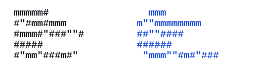

<picture>
  <source media="(prefers-color-scheme: dark)" srcset="assets/pubcom-dark.svg">
  
</picture>

<!--
 mmmmm         #        mmm
 #   "# m   m  #mmm   m"   "  mmm   mmmmm
 #mmm#" #   #  #" "#  #      #" "#  # # #
 #      #   #  #   #  #      #   #  # # #
 #      "mm"#  ##m#"   "mmm" "#m#"  # # #
-->


# PubCommittee

**Line-by-line public input on active bills.**

**Live demo:** https://pubcommittee.netlify.app

PubCommittee lets the public review active bills the way an editor reviews a draft. People comment on any line, suggest exact replacement text, and support or oppose a bill as a whole. Each line has a stable link, so a social media post can point to the exact words it quotes. Congressional offices get a short brief they can act on in minutes.

It is not a vote and it does not change bill text. It gives existing representatives a more specific signal. The first version covers the US Congress.

The M0 proof of concept (a static SvelteKit site on mocked data with no backend) is archived in [`demo/`](demo/README.md). The M1 web app in [`app/`](app/README.md) renders real bill text from `read-api`. See [`design/MILESTONES.md`](design/MILESTONES.md) for the roadmap.

## Guide for AI agents

Start here, then read only the files your task needs.

### Read order

1. [`PRODUCT_DOC.md`](PRODUCT_DOC.md): what the product is, who it is for, and its principles. Read this first for any product or design question.
2. [`design/README.md`](design/README.md): index of the feature docs (01–11) and how they depend on each other.
3. [`design/MILESTONES.md`](design/MILESTONES.md): what each milestone (M0–M6) delivers.
4. [`architecture/README.md`](architecture/README.md): stack, hosting, and storage decisions from M1 onward.
5. [`app/README.md`](app/README.md): how to run the web app and where its code lives. [`demo/README.md`](demo/README.md) covers the archived M0 demo.

### Folder map

```
pubcommittee/
├── README.md              this file
├── PRODUCT_DOC.md         product definition: problem, personas, principles
├── SECURITY.md            how to report vulnerabilities; scope
├── LICENSE                AGPL-3.0
├── assets/                README banner (light and dark SVG)
├── design/                stack-agnostic feature docs
│   ├── README.md          index and dependency sketch
│   ├── 01-…11-*.md        one doc per feature (ingestion, versions, review,
│   │                      lineage, roles, sharing, briefs, onboarding,
│   │                      integrity, machine access, AI security)
│   ├── MILESTONES.md      M0–M6 delivery plan
│   └── tasks/             work packages per milestone (M1 first)
├── architecture/
│   └── README.md          implementation architecture (Go on Google Cloud,
│                          REST/OpenAPI, adapters, ingest, notifications)
├── infra/                 public OpenTofu modules and example root
│   └── README.md          module rules; cloud runbook: first data in an
│                          environment, each new bill, new US Code release
├── demo/                  archived M0 proof of concept (static SvelteKit site
│                          on mock data; served from the Netlify site)
└── app/                   M1 web app (SvelteKit 3, Svelte 5, Tailwind 4,
    │                      adapter-node, PWA), renders from read-api
    ├── README.md          run commands and code map
    ├── package.json       scripts: dev, build, start, check, lint, test
    ├── static/            PWA manifest, icons, robots.txt
    ├── tests/             Playwright UI tests
    └── src/
        ├── hooks.server.ts    content negotiation (303 to read-api)
        ├── service-worker/    offline caching for the PWA
        ├── lib/
        │   ├── api/           generated types and the read-api client
        │   ├── server/        server-only code (environment, client)
        │   ├── components/    Svelte UI components
        │   ├── anchors.ts     line anchors, URL hashes, ranges
        │   ├── links.ts       URL builders
        │   └── placeholders.ts  registry of not-yet-built features
        └── routes/            pages (file-based routing)
```

### Where to look for a task

| Task | Look in |
| --- | --- |
| Why a feature exists or how it should behave | `PRODUCT_DOC.md`, then the matching `design/NN-*.md` |
| What is in scope now versus later | `design/MILESTONES.md` |
| Build work for a milestone | `design/tasks/README.md`, then the task file |
| Stack, hosting, data stores, API shape | `architecture/README.md` |
| Run jobs in a cloud environment (first data, new bill, new US Code release) | `infra/README.md` § Cloud runbook |
| Change demo data (archived M0) | `demo/src/lib/mock/` |
| Change a page | `app/src/routes/` |
| Change shared UI | `app/src/lib/components/` |
| Domain vocabulary | `app/src/lib/types.ts` and the design docs |
| Line links and sharing URLs | `app/src/lib/anchors.ts`, `app/src/lib/links.ts`, `design/06-sharing.md` |
| Security or privacy questions | `SECURITY.md`, `design/09-*.md`, `design/11-ai-security.md`; for how it is built, `architecture/README.md` § Identity and personal data and § What stays private |

### Answering design and architecture questions

For a question not covered above, follow these steps in order:

1. Match the question to a feature doc using the **Covers** column in [`design/README.md`](design/README.md). Read that doc for behavior, rules, and open questions.
2. For how it is built, scan the `##` headings of [`architecture/README.md`](architecture/README.md) (`grep -n '^## ' architecture/README.md`). They cover data placement, identity and personal data, bill source, AI-generated content, notifications, the API contract, hosting, and open decisions.
3. If neither index matches, search the docs for key terms and synonyms (for example district, jurisdiction, location):
   `grep -rniE 'district|jurisdiction' PRODUCT_DOC.md design architecture`
4. Cite the files you used, and separate decided behavior from items listed under "Open questions" or "Open decisions".

### Conventions

- The design docs name no languages, frameworks, or vendors. Put stack choices in `architecture/`, not `design/`.
- Code names follow design-doc vocabulary, for example steward, rider tag, brief, and suggested edit.
- Features not built yet appear as dashed buttons. They open a pop-up that names the milestone and design doc, through `app/src/lib/placeholders.ts`.

## Run the app

The whole app runs locally in Docker (Docker with Compose v2 is the only requirement): the web app, `read-api`, `admin-api`, and an OpenTelemetry Collector, over a data directory filled from the example bills in `fixtures/`. No cloud account and no model calls; explanations and summaries come from the fake generator.

```sh
scripts/local.sh build    # build every image
scripts/local.sh up       # serve; Ctrl+C stops it and removes every container and network
scripts/local.sh down     # stop and remove the stack (use after `up -d`, or to clean up after a crash)
scripts/local.sh test     # acceptance checks against the running app (start it first with `up -d`)
```

| Service | Address |
| --- | --- |
| Web app | http://localhost:3000 |
| `read-api` | http://localhost:8080 (spec at `/v1/openapi.yaml`) |
| `admin-api` | http://localhost:8081, for `pubctl` ([cmd/pubctl/README.md](cmd/pubctl/README.md)) |

- **First run.** `up` fills `.local-data/` when it is empty: US Code provisions, selection policy v1, the 200-bill catalog sample, the three exit bills with every version, citations and comparisons, generated explanations, exports, and the change feed. `scripts/local.sh seed` refills it on demand.
- **In the background.** `scripts/local.sh up -d` returns once every service is healthy; stop it with `scripts/local.sh down`.
- **Start over.** Your data stays in `.local-data/` (git-ignored) across runs. Delete that directory to start from the example data again.
- **Settings.** `COMPOSE_PROJECT` names the Compose project (default `pubcommittee`). `RATE_LIMITS` overrides `read-api`'s limits, which the script lifts for a single local user.
- **Acceptance checks.** `test` runs, against the running app: the HTTP checks of `test/acceptance/M1-01`, `M1-03a` and `M1-16` (every M1 exit criterion on the three exit bills), then the M1-16 browser checks in Playwright (pages without scripts, labels, version history, catalog, installability, offline). It changes nothing in your data. `test --with-admin` also drives `admin-api` with `pubctl` (track, then untrack a bill), which adds entries to the public log. Ctrl+C stops the checks and removes their containers; the app keeps running. Code-level checks (`go test`, lint, the API spec) run in CI and in the dev container, not here.
- **Live-model data.** `scripts/local.sh data live` switches to the stored outputs of the M1-09 live-model run (real paraphrased explanations; no key or model call), and `scripts/local.sh data fake` switches back. The set not in use is kept in `.local-data.<name>/`; a running stack is restarted on the new set. `scripts/local.sh data` shows which set is in use.
- **One job at a time.** `scripts/local.sh job job-ingest --bill <id> --track` (likewise `job-summarize`, `job-exports`; flags in each `cmd/<job>/README.md`). It runs as your user, so files in `.local-data/` stay yours, and works with the stack up or down.

Front-end work with hot reload, against a running stack:

```sh
cd app
npm install
READ_API_URL=http://localhost:8080 npm run dev      # http://localhost:5173
npm run check    # type check
npm run build    # Node server in app/build/ (run with `npm start`)

# The archived M0 demo builds on its own:
cd ../demo && npm install && npm run build   # static site in demo/build/
```

## License

[AGPL-3.0-or-later](LICENSE). To report a vulnerability, see [SECURITY.md](SECURITY.md).
